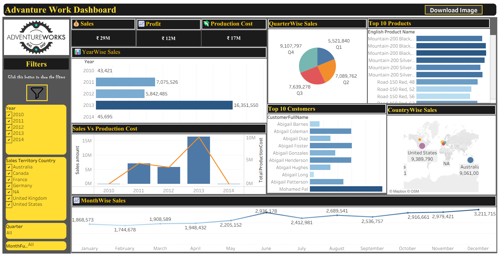

# Menni Posibabu | Data Analyst Portfolio

A personal portfolio website built with HTML, CSS and JavaScript to showcase
my data analytics skills, projects and experience.

🔗 **Live site:** https://posi19babu.github.io/portfolio/

---

## 👋 About

I'm a B.Sc Computers graduate (2026) who trained in data analytics.
I enjoy cleaning messy datasets, asking the right questions and turning
the answers into dashboards and reports.
I'm looking for an **entry-level Data Analyst** role.

📍 Rajahmundry, Andhra Pradesh, India

---

## 🛠️ Skills

| Area | Tools |
|------|-------|
| Programming & Databases | Python, SQL (MySQL), C |
| Data Analysis | Data Cleaning, EDA, Preprocessing, Pivot Tables, Excel |
| Visualization & BI | Power BI, Tableau, Dashboards, Reporting |
| ML & Web | CNN, Model Evaluation, HTML, CSS, JavaScript, Bootstrap |

---

## 📊 Projects

### 1. Adventure Works Sales Analysis
**Tools:** Excel, Power BI, Python, MySQL
- Answered business questions on revenue, product performance and
  customer behaviour using sales, product and customer data
- Cleaned, joined and summarised the data with SQL and Python
- Built an interactive Power BI dashboard and Excel pivot reports

### 2. Driver Drowsiness Detection using CNN
**Tools:** Python, Machine Learning, CNN
- Built a CNN that detects driver drowsiness from eye images and video
- Preprocessed the data, then trained and evaluated the model
- Added real-time detection that raises an alert when drowsiness is detected

---

## 💼 Experience

**AI and ML Intern** | ABN & PRR College of Science, Kovvur
*Dec 2025 to Mar 2026*
- Applied AI and ML concepts to a real-world project in Python
- Handled data preprocessing, model training and evaluation

---

## 🎓 Education

| Qualification | Institution | Year | Score |
|---------------|-------------|------|-------|
| B.Sc, Computers | ABN & PRR College of Science, Kovvur | 2023 to 2026 | CGPA 8.39 |
| Intermediate (M.P.C) | Govt. Junior Boys College, Kovvur | 2023 | 76.3% |
| SSC | KSR Govt. High School, Vegeswarapuram | 2021 | 76.8% |

**Certifications:** Data Analytics (NASSCOM, 2026), Programming in C (Infosys, 2024),
Computer Science 101 (edX, 2024)

---

## 📁 Project Structure
portfolio/
├── index.html
├── Advanture_Works.png
├── Driver_Drowsiness.png
├── my_photo.jpeg
├── MyResume.docx
└── README.md

---

## 🧰 Built With

HTML5 · CSS3 · JavaScript · Hosted on GitHub Pages

---

## 📬 Contact

- 📧 Email: posibabu414@gmail.com
- 💼 LinkedIn: https://linkedin.com/in/posibabu-menni-a346b5442
- 🐙 GitHub: https://github.com/posi19babu
